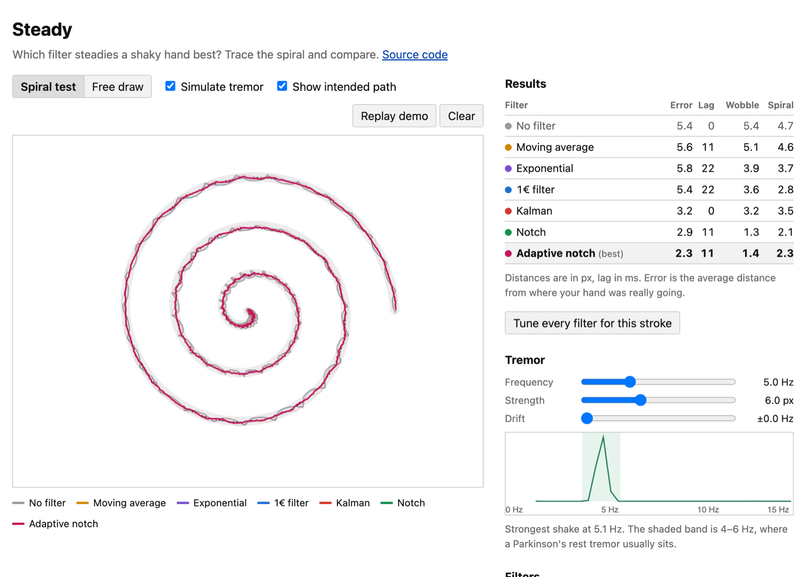

# Steady

**Try it: https://burthebear.github.io/steady/**

When I was working on [TypeParkinson](https://github.com/BurTheBear/TypeParkinson-CAC), a keyboard for people with Parkinson's, I kept running into the same question: if you want to smooth out a shaky hand, which filter should you use? Steady lets you draw with a simulated tremor (or your real one) and watch five filters try to clean it up, side by side, with numbers.



## What it does

- **Spiral test.** You trace an Archimedean spiral. This is the same shape doctors use in spiral-drawing tests for tremor. Steady measures how far each filter's version strays from it.
- **Simulated tremor.** A 4–6 Hz wobble (the usual range for a Parkinson's rest tremor) is added on top of your pointer, so you know exactly what you *meant* to draw. That makes it possible to score error, lag and leftover wobble separately.
- **Spectrum.** It resamples your input to 100 Hz and runs a Fourier transform to find the strongest shake frequency.
- **Tune.** One button grid-searches each filter's settings for the stroke you just drew.

## The filters

| Filter | Idea |
|---|---|
| Moving average | Average the last *n* points. |
| Exponential | Move a fixed fraction of the way toward each new point. |
| [1€ filter](https://gery.casiez.net/1euro/) | A low-pass filter whose cutoff rises with speed. It smooths a lot when you're slow and gets out of the way when you're fast. |
| Kalman | Keeps an estimate of position *and* velocity, predicts ahead, then corrects with each reading. |
| Notch | Removes one narrow band of frequencies, ideally the tremor's, and leaves everything else. |

## What I found

On the built-in demo (a 5 Hz, 6 px tremor while tracing the spiral at a normal pace), with each filter tuned by the Tune button:

| | Error (px) | Lag (ms) | Wobble left (px) |
|---|---:|---:|---:|
| No filter | 5.4 | 0 | 5.4 |
| Moving average | 5.4 | 0 | 5.4 |
| Exponential | 5.1 | 11 | 4.7 |
| 1€ filter | 4.6 | 22 | 4.1 |
| Kalman | 3.1 | 0 | 3.1 |
| Notch | 2.0 | 11 | 1.6 |

The surprise for me was that the simple filters barely help. When the hand is moving, any filter strong enough to remove a 5 Hz shake is also slow enough to fall behind, and the lag costs about as much accuracy as the shake did. The Kalman filter avoids most of that because it predicts where the hand is going. The notch filter does best, because a tremor is close to one steady frequency, so it can be cut out without slowing everything else down.

One caveat: the simulated tremor is a clean sine wave, which flatters the notch filter. A real tremor drifts in frequency, so in practice you'd want the notch to follow the measured frequency. The "Match the measured shake" button does that once. Doing it continuously is the next thing I want to try.

## Running it

```bash
python3 -m http.server 8000   # then open http://localhost:8000
npm test                      # filter and signal tests (Node 20+)
```

No libraries. The filters are in `src/filters.js` and the tremor model, scoring and spectrum are in `src/signal.js`.

This is for exploring filters. It isn't a medical tool and doesn't diagnose anything.

MIT license.
